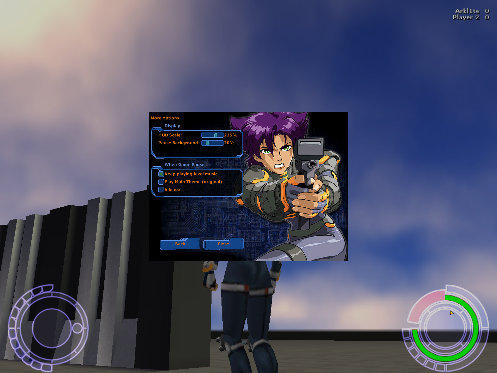

# Arklite for Oni


(See screenshots folder for more...)

Quality-of-life fixes and network multiplayer for [Oni](https://oni.bungie.org/)'s Anniversary
Edition, in one DLL. It patches the game in memory when it starts, so no game file is changed.

Arklite's aim is to be the Oni update that never came.

## Features

- **Network multiplayer** for 2 to 4 players (as many as the map has spawn points). Host a map from the menu, or join one from the server list, your saved servers or your local network: games on the internet are listed and reached for you, even behind a provider's shared address. Your game never shows anyone's address, so you can stream it. Players fight in a warm-up until enough of them are ready (F3), and anyone can join while a warm-up or match is on; matches have time and score limits, a kill feed in the top left corner (who killed whom, and how, in icons), a scoreboard (F1) and chat (Enter), which also says when someone enters or leaves the game. Type /help in the chat for its commands: /name, /w (whisper), /moves (your character's move list), /t and /t2 (taunts), /sneeze, /i (idle), /clear. The other players are predicted, so there's no input delay.
- **Pick your character with F2**, from Konoko to Mad Bomber, with their outfits and colors. Type your name there too, and it shows over your head.
- **Barabas can regenerate** when you play him: crouch, let go of crouch, then press Action.
- **Custom Game** on the main menu lists every custom level. Play it alone or host it. Joiners who don't have the map download it from the host, and a host whose AE mods changed level0 sends joiners only what differs, kept apart from their own files.
- **HUD scaling** from 50% to 300%, and stays (almost) sharp. The stock HUD gets tiny at high resolutions.
- **Sound, Music and Voice volume bars**, with all character speech and taunts on Voice.
- **An FPS counter**, off by default, in Options > More...
- **Mouse sensitivity** in Options > More...: a slider from 0.10 to 4.00, and a box beside it for any exact value, higher or lower (1.000 is Oni's own speed).
- **Mouse wheel in the menus**: it scrolls lists, moves the slider under the cursor and turns the pages of the F1 screen.
- **Transparent pause menu**, and the level music keeps playing behind it if you like.
- **255 characters**, all active at once, so big fights no longer crash the game.
- **Fixed skybox** along the edges of the sky.
- **Fixed tiny strikers** outside the dream lab.
- **Screenshots with F12**, anywhere: in a level, in the menus or while a level loads. They're saved as PNG in `AE/screenshots/`, and you hear the game-saved sound when one is done.
- **A crash log** in `AE/logs/`, dated, with the last three games kept, for when something goes wrong.

Everything is in Options → **More...** and in the **Custom Game** menu. Press F1 in a match for the scoreboard, and F2 to change character.

## For modders

- **A folder per custom level.** Drop it in `GameDataFolder/CustomLevels/`. A level doesn't need its own level number, and its files never replace the original levels. It can bring its own BSL scripts (`IGMD/`) and up to 8 plugin `.dat` files.
- **Dynamic vertex lighting.** Lights pulse, flicker or break down, from a `vertexlight.bin` next to the level, and can play a sound on each pulse or failure.
- **Spinning particles.** Particles in a Catwalk level's spinning groups turn with the group, from a `spinparticles.bin` next to the level.
- **A floor for the sky.** A sky with a sixth texture draws it under the box.
- **Kill cameras in multiplayer.** A level's `cm_detach` keeps only the dead player's camera in place, until they respawn.
- **255 characters, 255 active, 255 shadows**, up from 128, 64 and 32.
- **Multiplayer maps from any level.** Every character with the IsPlayer flag is a spawn point, and each weapon or power-up can set its own respawn time.
- **Maps travel by themselves.** A joiner whose map differs or is missing gets the host's copy.
- **Jump straight in for testing.** `ARKLITE_AUTOSTART=<folder>` starts a level from the command line, and `ARKLITE_SAVEPOINT=<n>` starts it at a save point.
- **Record and replay** a level's input, with every tick checked against the recording.
- **Crash reports you can read.** The registers and the stack values that point into Oni, Daodan or Arklite.

## Install

You need Oni with the [Anniversary Edition](https://oni.bungie.org/) installed. Download
`Arklite-<version>.zip` from the [Releases](../../releases) page and extract it into `Oni/AE/`.
Close Oni, then:

### Windows

Double-click `install.bat`. If Oni is in `C:\Program Files (x86)`, right-click it and choose
**Run as administrator**.

### Linux / macOS (Wine)

```sh
./install.sh
```

It finds the game in the usual Wine, Lutris and Bottles folders. Otherwise, pass the AE folder:
`./install.sh "/path/to/Oni/AE"`.

Start Oni from `Oni/AE/` as usual: the main menu now has a **Custom Game** button.

To update, run the new version's installer, and run it again after the AE Installer. `uninstall.bat` or `./uninstall.sh` removes Arklite and keeps your saves.

More details in [TECHNICAL.md](TECHNICAL.md).

---

<sub>Arklite is an unofficial fan project, not affiliated with or endorsed by Bungie, Take-Two
Interactive or Rockstar. It contains no Oni code or data: you need your own copy of Oni.</sub>
